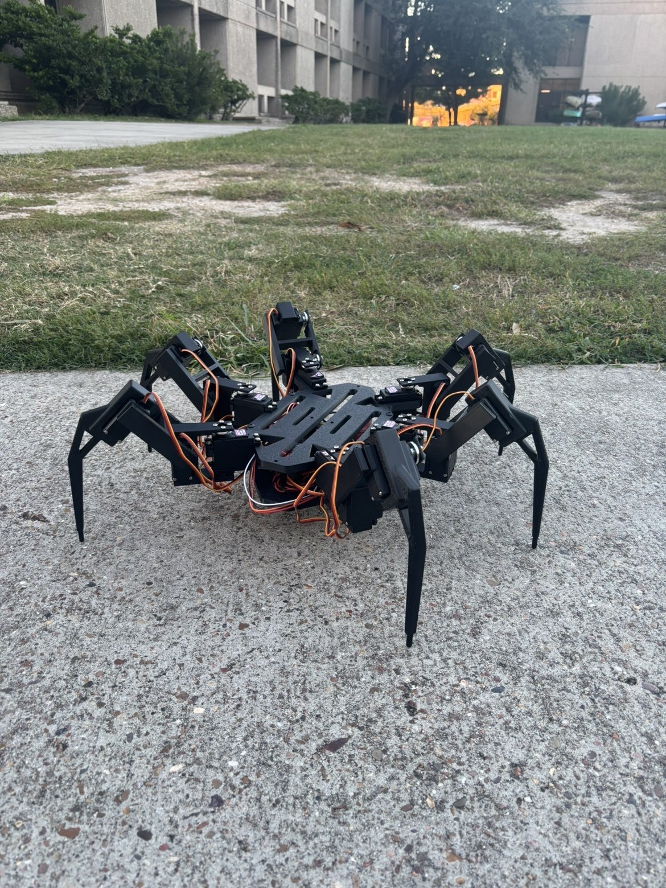
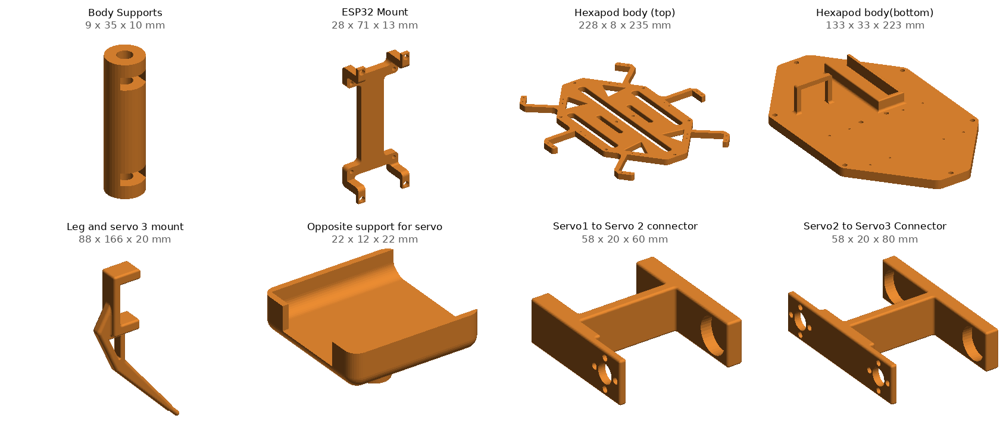
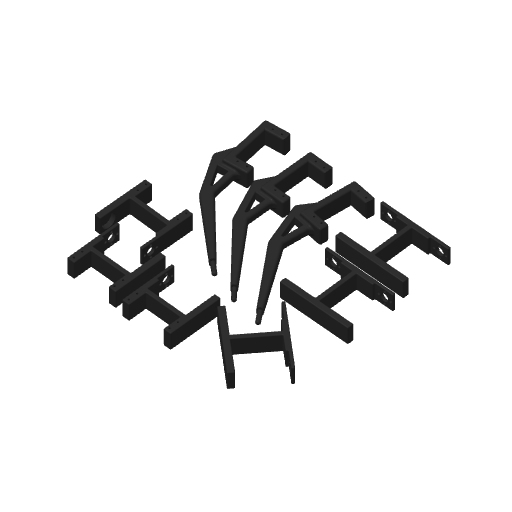
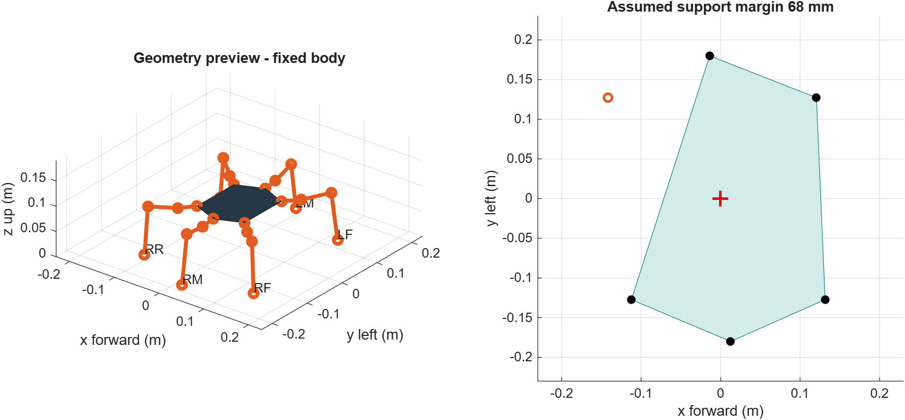
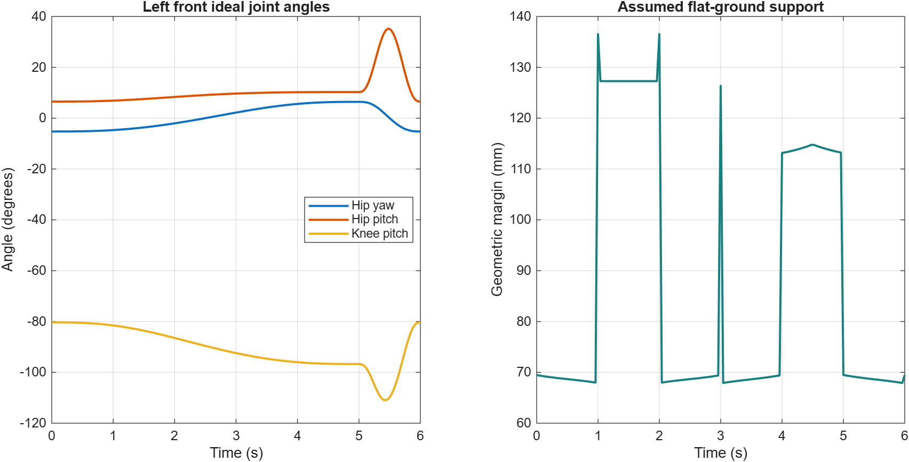
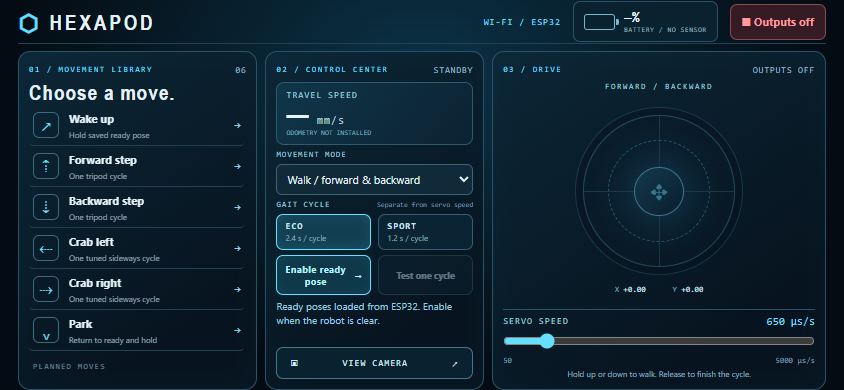
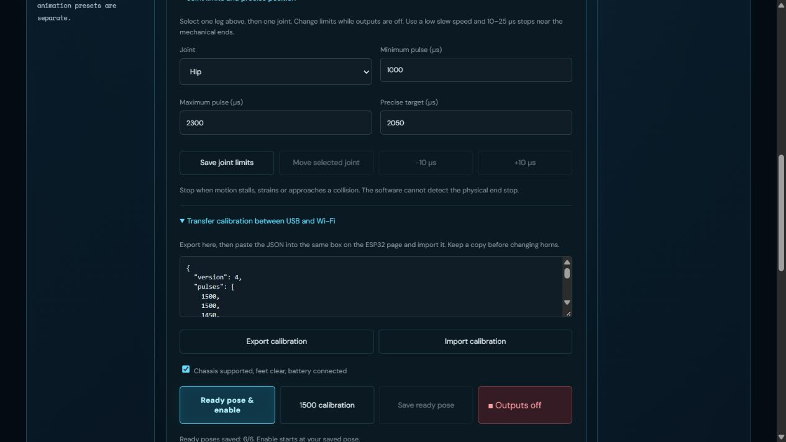
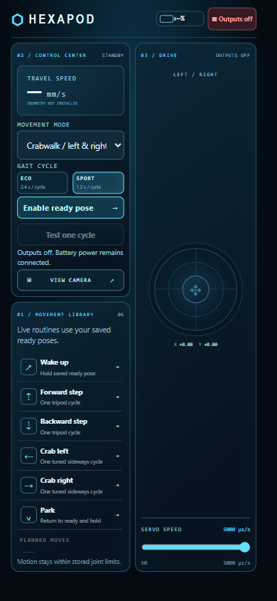
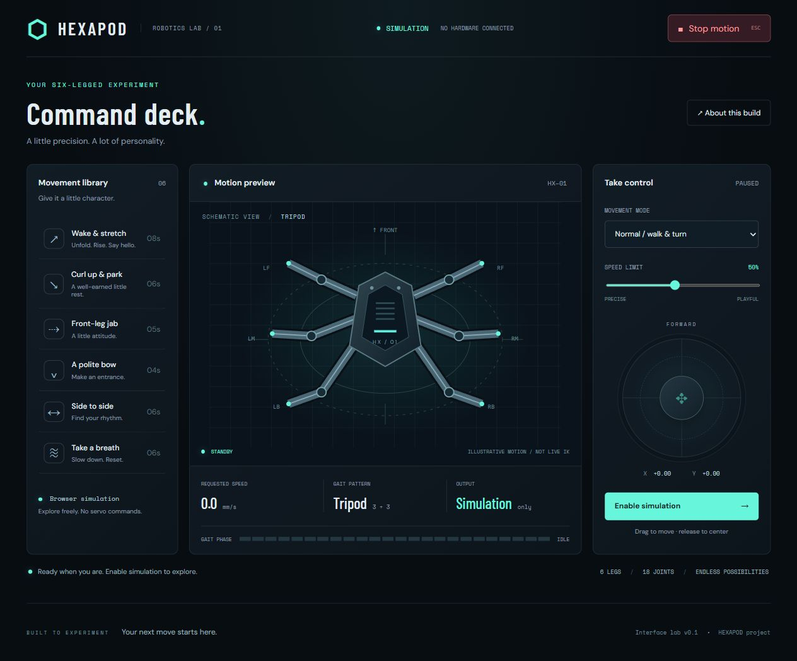

# P3DRO Hexapod

**Maxwell Tyler**, Mechanical Engineering student, Texas A&M University at Galveston ·
[LinkedIn](https://www.linkedin.com/in/maxwellbtyler29)

I built **P3DRO**, a six-legged walking robot. I designed it in SolidWorks, 3D-printed the structure, and
run it with an ESP32 that drives 18 MG996R servos through two PCA9685 PWM boards. I tested gait and torque in
MATLAB/Simscape at the measured mass (1.75 kg), and I control the robot from a phone or laptop with a web app
called **Hexapod Command**, over USB serial or the robot's own Wi-Fi. Mid-September – October 2026.


<sub><b>P3DRO</b> — assembled hexapod on an outdoor walk (bare printed foot tips).</sub>


<sub>The structural parts I designed in SolidWorks, rendered from the STL files in <code>cad/print/</code>.</sub>

## Status (October 2026)

**Status: complete / walking (Eco & Sport).**

- ✅ Structural parts designed in SolidWorks and 3D-printed on a Bambu Lab P1S; full robot assembled.
- ✅ Electronics wired: ESP32 + two PCA9685 boards over I²C, servo power from a 2S LiPo through an SBEC (~5 V). Rail measured **5.14 V** under load on the bench; outdoor walks run the full 18-servo load.
- ✅ Firmware verified over USB/Wi-Fi. Per-servo calibration (ready pose and limits) stored in ESP32 flash (NVS).
- ✅ Bench bring-up logged in [`docs/six-leg-setup.md`](docs/six-leg-setup.md); Simscape gait study at measured **1.75 kg** (230 g/leg + 370 g body+electronics).
- ✅ Outdoor walk in **Eco and Sport** on the current MG996Rs. Battery sits mid-to-aft lengthwise. Rubber foot caps removed — bare printed tips walked better.
- ✅ **Project complete** — it walks; I'm not continuing active development from here.
- Optional / unavailable in UI (not active work): battery-voltage sensing, odometry, and a camera stay shown as "unavailable" instead of faked values.

## Features

- **18-DOF hexapod**: 6 legs × 3 joints (hip, knee, foot), with mirrored left/right leg parts.
- **Tripod gait on the ESP32**: walk forward/backward, turn, and crab sideways. The ESP32 generates the gait on a fixed
  20 ms tick, so servo timing doesn't depend on the network. There are two tempo profiles, Eco (2.4 s cycle) and Sport (1.2 s cycle), plus an
  adjustable servo slew limit.
- **Web controller ("Hexapod Command")**: movement library, joystick, gait mode and speed, and an **Outputs off** kill switch.
  It connects over **USB (Web Serial)** or the robot's **Wi-Fi access point**. The ESP32 serves the page itself at `192.168.4.1`.
- **Calibration page**: per-joint min/max pulse limits, ready pose, direction checks, and JSON export/import of calibration.
- **Safety behavior**: outputs disable on a link-loss watchdog or an I²C fault, and walking only repeats after a one-cycle test in that direction.
- **Simulation**: a Simscape Multibody model imported from my SolidWorks assembly, plus MATLAB IK/FK scripts.

## Hardware

| Component | Part used | Qty |
| --- | --- | --- |
| Microcontroller | AITRIP ESP-WROOM-32 dev board (USB-C) | 1 |
| Servo drivers | PCA9685 16-channel PWM boards (I²C 0x40 = left legs, 0x41 = right legs) | 2 |
| Servos | Deegoo MG996R | 18 for the full robot |
| Battery | Zeee 2S 7.4 V 2200 mAh LiPo, XT60 | 1 |
| Regulator | YPG 20 A SBEC (servo rail set to ~5 V) | 1 |
| Charger | OVONIC D15 balance charger | 1 |
| Structure | 3D-printed parts (Bambu Lab P1S) | see [`cad/`](cad/) |
| Fasteners, wiring, fuse | See the audit doc | see docs |

## Mechanical design



All parts were modeled in **SolidWorks** ([`cad/`](cad/)). Each leg is a chain of three servos joined by printed
brackets: *Servo 1 → Servo 2 connector*, *Servo 2 → Servo 3 connector*, and *Leg and servo 3 mount* (the lower leg/foot).
Each bracket has an *Opposite support* on the far side of the servo. The right-side legs use mirrored versions of these parts.
The body is a top plate and a bottom plate held apart by printed supports, with mounts for the ESP32, SBEC, and battery.

Before printing all six legs, I printed small "hole practice" pieces to tune hole and fit tolerances, then printed one
leg as a fit test. I also modeled the purchased parts (servo, ESP32, PCA9685, SBEC, battery) to check fit in the
assembly. STL files and Bambu Studio print plates are in [`cad/print/`](cad/print/).

<br clear="right">

## Electronics and control architecture

```
2S LiPo ──XT60──> SBEC (~5 V) ──> PCA9685 V+ servo rails ──> 18× MG996R
                                        ▲
ESP32 ──I²C (SDA GPIO21 / SCL GPIO22)───┘  PCA9685 #1 @0x40: left legs  (ch 0-8: hip/knee/foot ×3)
  │                                        PCA9685 #2 @0x41: right legs (ch 0-8)
  ├── USB serial ──> laptop (Hexapod Command over Web Serial, Python console tools)
  └── Wi-Fi AP "Hexapod-Control" ──> phone browser at http://192.168.4.1/
```

The firmware ([`firmware/`](firmware/)) is a PlatformIO/Arduino project. Besides the
main six-leg controller, it has small bring-up programs I used step by step: an I²C scanner, a single-servo bench, a
one-leg bench, and batch centering. The gait generator (`gait.h`) plans a time-based tripod gait, and each planned
trajectory is checked against every joint's saved calibration limits before it runs. More detail is in
[`docs/control.md`](docs/control.md) and [`firmware/README.md`](firmware/README.md).

## Simulation

I exported the SolidWorks assembly to **MATLAB Simscape Multibody** (Multibody Link). The standing model in
[`simulation/simscape/hex_simulation_standing.slx`](simulation/simscape/hex_simulation_standing.slx) is what the gait
study starts from. That study drives the model with the same tripod gait as the firmware, at the measured 1.75 kg
([`simulation/gait/`](simulation/gait/)). I also used base-MATLAB inverse/forward kinematics and foot-path
scripts to check reach and joint angles ([`simulation/kinematics/`](simulation/kinematics/)).

 

## Web app: Hexapod Command

| Landscape (phone) | Calibration |
| --- | --- |
|  |  |

 

- [`controller/`](controller/): Hexapod Command (static HTML/CSS/JS in `dist/`). It talks to the robot through Web Serial (USB) or HTTP (Wi-Fi).
- [`firmware/deck/`](firmware/deck/): the phone deck and calibration page that `pack_web.py` embeds into the firmware at build time.

## Repository structure

```
hexapod-robot/
├── cad/
│   ├── parts/             SolidWorks structural parts (filenames kept; see cad/README.md)
│   ├── components/        Purchased-part reference models
│   ├── assemblies/        Full body, one leg, Simscape export assemblies
│   └── print/             STL exports and Bambu Studio print plates
├── simulation/
│   ├── kinematics/        MATLAB IK/FK, foot path, gait preview
│   ├── simscape/          Standing Simscape model, STEP geometry, export data
│   └── gait/              v6 tripod gait study at the measured 1.75 kg
├── firmware/              ESP32 project, phone deck, leg IK, desktop preview, tests
├── controller/            Hexapod Command web app
└── docs/                  Commissioning log, control notes, bench notes, photos
```

## Build, upload, and run

**Requirements:** [PlatformIO](https://platformio.org/) (CLI or VS Code extension), Python 3, Node.js (for the tests), and a USB-C data cable.

1. **Set the Wi-Fi password.** Copy `firmware/src/wifi_secrets.example.h` to `wifi_secrets.h` in the
   same folder, and set your own access-point password (8+ characters). `wifi_secrets.h` is git-ignored.
2. **Build and upload** (with the servo battery disconnected for the first upload):
   ```bash
   cd firmware
   pio run -e six_leg_setup -t upload --upload-port <port>
   ```
   `pack_web.py` runs automatically and embeds the web pages. Other environments: `i2c_check`, `servo_bench`, `leg_bench`, `batch_center`.
   Updating the firmware keeps calibration as long as you **don't erase flash**.
3. **Connect.** Join the `Hexapod-Control` Wi-Fi network and open `http://192.168.4.1/` (calibration is at `/calibration/`),
   or open Hexapod Command on a laptop and connect over USB.
4. **Commission the legs.** Follow [`docs/six-leg-setup.md`](docs/six-leg-setup.md): check directions, save limits and ready poses,
   then run one test cycle per direction before holding the joystick.

**Tests** (no hardware needed), from the repository root:
```bash
g++ -std=c++17 -Ifirmware/tests/v6_stubs firmware/tests/test_six_leg_v6.cpp -o /tmp/t6 && /tmp/t6
g++ -std=c++17 firmware/tests/test_gait.cpp -o /tmp/tg && /tmp/tg
g++ -std=c++17 firmware/leg-ik/test_ik.cpp -o /tmp/ti && /tmp/ti
node --test controller/tests/*.test.cjs firmware/tests/test_link.js
# 19 of the controller tests pass. One assertion in controller/tests/serial.test.cjs
# (a firmware error should mark the link disconnected) still fails.
```

## What I learned

- **Design for the printer and the parts you actually have.** Printing hole-practice pieces and a single fit-test leg caught
  tolerance problems before I printed all six legs. Modeling the real servo and boards in SolidWorks made the packaging decisions concrete.
- **Power is a design problem, not a wiring detail.** 18 servos need a regulated rail sized for their current. I had to keep the ESP32 logic, the PCA9685 logic,
  and the servo power separate with a shared ground, and I measured the rail with a meter during loaded tests.
- **Bring hardware up one layer at a time:** I²C scan → one servo → one leg → two legs → six legs. Each step got its own test firmware and a written log.
- **Weigh and re-sim before buying stronger parts.** Measured mass (1.75 kg) drove the Simscape torque study; outdoor walks confirmed both Eco and Sport on the current MG996Rs.
- **Simulation first, then hardware.** Building the Simscape model in stages showed me how the CAD, kinematics, and gait fit together before moving real servos.
- **Calibration matters.** Hobby servos don't report their position, so I added saved per-joint limits, ready poses, and conservative startup/stop behavior.

## Project complete

P3DRO walks outdoors in Eco and Sport on the current MG996Rs. Measured mass drove the Simscape study; hardware settled the Sport call. Battery packaging is mid-to-aft lengthwise — no nose-forward CoM move on the robot.

Left on the table (not active work): battery-voltage sensing, odometry, camera feed, and rougher-terrain experiments.

---
*Personal engineering project by Maxwell Tyler, 2026.*
